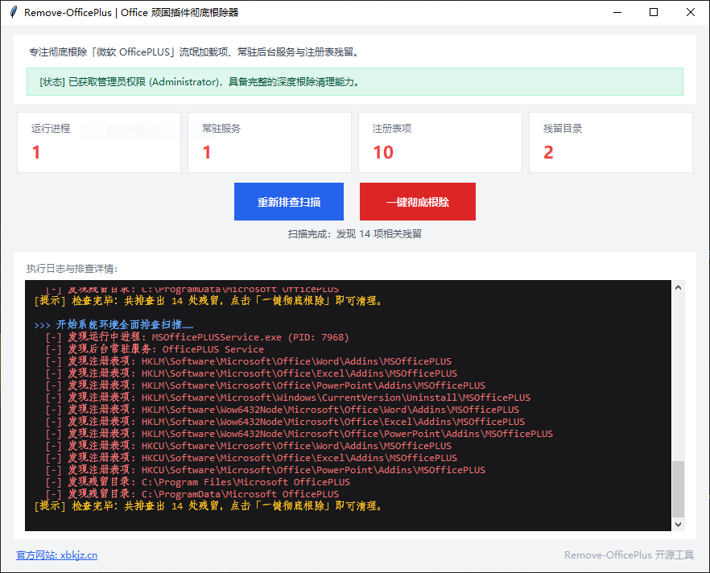
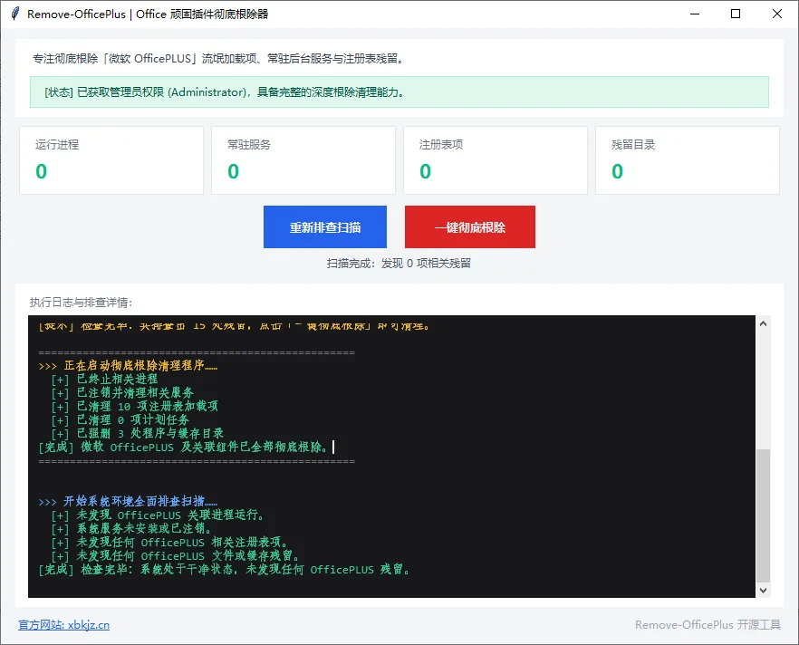
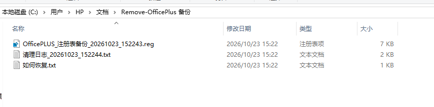

# Remove-OfficePlus

<p align="center">
  <b>一键清理「微软 OfficePLUS」Office 加载项、后台服务和残留文件，删除前自动备份。</b><br>
  <i>Remove the Microsoft OfficePLUS add-in and its background service, with automatic registry backup.</i>
</p>

<p align="center">
  
  
  
</p>

---

## 为什么需要这个项目

不少用户发现电脑里多了「微软 OfficePLUS」（也叫「微软 PPT 助手 / Office 助手」），却不记得自己装过。

手动卸载时常见这些问题：
1. **无法关闭**：在 Word / Excel / PowerPoint 选项中取消勾选插件，重启 Office 后依然被强制勾选加载。
2. **无法删除**：文件管理器删除提示「文件已被占用」，无法正常删除。
3. **会重新出现**：即使用某些工具删除了部分文件，开机后又被后台服务自动下载或修复恢复。

### 为什么取消勾选没用
- **系统服务**：常驻运行 `OfficePLUS Service`（`MSOfficePLUSService.exe`），以 `LocalSystem` 最高权限开机自启。
- **系统级注册表加载**：在 `HKEY_LOCAL_MACHINE`（而非当前用户 `HKCU`）写入 `LoadBehavior = 3`（随 Office 启动自动加载）。系统级的加载项设置优先于用户在 Office 选项里的勾选，所以取消勾选后重启又会被加载。
- **缓存文件**：在 `ProgramData` 与 `AppData` 存有配置文件与更新种子。

---

## 核心特性

- **全链路清理**：进程 ➔ 服务 ➔ 注册表（HKLM / HKCU / 32 位 / 即点即用版 Office）➔ 计划任务 ➔ 缓存目录。
- **按特征识别**：除了已知名称，还会找出名称、描述里带「OfficePLUS」的加载项，以及程序指向 `MSOfficePLUSService.exe` 的服务，改了名也能找到；其他加载项和服务一概不碰。
- **先备份再删除**：删除前把注册表导出成 `.reg` 备份，备份失败就不删；每次清理都留一份日志，删完自动复检。
- **桌面图形界面**：提供原生 GUI 窗口，排查状态与清理结果一目了然。
- **零依赖运行**：PowerShell 脚本和独立 exe，Windows 10 / 11 无需安装任何环境。
- **自动提权**：需要管理员权限时自动弹出 UAC；用其他管理员账号授权时，清理的仍是当前登录用户的数据。
- **只看不删**：支持仅扫描（`-Scan` / `--scan`）和预演（`--dry-run`），先看清楚再决定。

目前专门针对 OfficePLUS。如果你遇到了它的新变种或类似的加载项，欢迎提交 Issue。

---

## 运行前须知

- **会关闭 Office**：清理时要结束 Word、Excel、PowerPoint、Outlook 才能删掉被占用的文件。检测到它们在运行时会先提醒你保存，请先保存好正在编辑的文档。
- **需要管理员权限**：系统服务和全局注册表只有管理员才能删除，运行时会弹出 UAC 提示。
- **备份和日志的位置**：`文档\Remove-OfficePlus 备份`。里面有注册表备份（`.reg`）、《如何恢复.txt》和每次的 `清理日志_日期_时间.txt`。
- **如何恢复**：双击备份的 `.reg` 文件导入即可恢复注册表；删除的程序文件不会恢复，需要的话重新安装即可。
- **只想先看看**：用扫描或预演模式，不会做任何修改（见下方参数表）。

---

## 快速使用方法

### 方式 1：下载独立绿色版程序（小白推荐）

1. 前往 GitHub 的 [Releases 页面](https://github.com/HenryYannis/Remove-OfficePlus/releases) 下载最新版的 `Remove-OfficePlus-GUI-v版本号.exe`（例如 `Remove-OfficePlus-GUI-v1.2.1.exe`）。打不开 GitHub 的话，可以从[国内下载页](https://files.xbkjz.cn/apps/officeplus/)下载。程序窗口右下角显示当前版本号，点「下载最新版」也会打开这个页面。
2. 双击运行程序，在弹出的 UAC 提示中点击「是」授权管理员权限。
3. 点击「一键清理」即可全自动完成清理与复检。

> **Windows 提示「已保护你的电脑」？** exe 没有购买代码签名证书，第一次运行时 SmartScreen 可能拦截。点「更多信息」→「仍要运行」即可。
>
> **校验文件**：Release 里附有 `SHA256SUMS.txt`。在 PowerShell 里运行 `Get-FileHash .\Remove-OfficePlus-GUI-v*.exe`，结果和文件里的值一致，说明下载的文件没有被改动。

---

### 方式 2：PowerShell 一键在线运行（极速免下载）

无需下载任何文件，直接在 Windows 桌面按快捷键 `Win + X` 打开「终端」或「PowerShell」，粘贴并运行以下命令：

```powershell
# 运行极速排查与彻底清理
irm https://raw.githubusercontent.com/HenryYannis/Remove-OfficePlus/main/scripts/Remove-OfficePlus.ps1 | iex
```

脚本会先扫描并列出发现的残留，确认后才清理。这条命令始终运行仓库里的最新版本；如果想先看看脚本内容，可以在浏览器里打开上面的链接。

---

### 方式 3：本地双击脚本运行（源码离线推荐）

1. 下载本仓库源码压缩包并解压。
2. 双击运行根目录下的 `Quick-Remove.bat`。
3. 在弹出的 UAC 管理员提权窗口点击「是」即可全自动清理。

---

### 方式 4：Python 命令行与源码运行

如果你已安装 Python 3.8+ 环境：

```bash
# 启动图形桌面窗口 (默认)
python main.py

# 仅命令行扫描诊断
python main.py --scan

# 预演：列出清理时会删除的项目，不做任何修改
python main.py --dry-run

# 命令行执行清理（会先列出要删的项目并询问确认，加 -f 跳过确认）
python main.py --nuke

# 查看版本号
python main.py --version
```

---

## 命令行参数

| PowerShell 脚本 | Python 版 | 作用 |
| :--- | :--- | :--- |
| （不带参数） | `--cli` | 扫描后询问是否清理 |
| `-Scan` | `--scan` | 只扫描，不做任何修改 |
| — | `--dry-run` | 预演：列出清理时会删除的每一项，不做任何修改 |
| `-Nuke` | `--nuke` | 执行清理。Python 版会先列出要删的项目并询问确认；Office 在运行时两者都会先提醒保存 |
| `-Force` | `-f` / `--yes` | 跳过确认，直接清理 |
| `-NoBackup` | — | 不备份注册表（不建议） |
| — | `--version` | 显示版本号 |

Python 版不带参数时启动图形界面。

---

## 实测效果

2026-10-23 我在一台 Windows 10 电脑上实测了 v1.1.0：无论是 Office 自动装上的 OfficePLUS，还是从官网下载安装包装的，都能扫描出来并清理干净，复扫为 0。

| 清理前扫描 | 清理后复扫 |
| :---: | :---: |
|  |  |

清理前会自动备份注册表，和清理日志一起放在「文档\Remove-OfficePlus 备份」：



原始日志和注册表备份见 [docs/real-test](docs/real-test/)。

---

## 清理覆盖范围

| 模块类别 | 目标路径 / 标识 | 处理方式 |
| :--- | :--- | :--- |
| **后台服务** | `OfficePLUS Service`，以及程序路径指向 `MSOfficePLUSService.exe` 的任何服务 | 停止并使用 `sc delete` 彻底注销服务 |
| **占用进程** | `MSOfficePLUSService`、`OfficePLUS.AgentLauncher`、`DeepLink` 等 | 强制终止 |
| **系统注册表（64 位）** | `HKLM:\Software\Microsoft\Office\<App>\Addins\MSOfficePLUS` | 彻底移除加载项 |
| **系统注册表（32 位兼容）** | `HKLM:\Software\Wow6432Node\Microsoft\Office\<App>\Addins\MSOfficePLUS` | 彻底移除加载项 |
| **用户注册表** | `HKCU:\Software\Microsoft\Office\<App>\Addins\MSOfficePLUS` | 彻底移除加载项 |
| **按特征识别的加载项** | 以上各位置及即点即用版 Office 的虚拟注册表中，名称、FriendlyName、Description 或 Manifest 含「OfficePLUS」的加载项 | 彻底移除加载项 |
| **卸载残留** | `...\Uninstall\MSOfficePLUS` | 清理控制面板残留键 |
| **计划任务** | 名称或路径含「OfficePLUS」的计划任务 | 删除 |
| **安装目录** | `%ProgramFiles%\Microsoft OfficePLUS`、`%ProgramFiles(x86)%\Microsoft OfficePLUS` | 彻底删除所有二进制与 DLL 文件 |
| **系统与应用缓存** | `%ProgramData%\Microsoft OfficePLUS`<br>`%LOCALAPPDATA%` 和 `%APPDATA%` 下的 `OfficePLUS`、`Microsoft OfficePLUS` | 彻底清空数据与配置 |

全部规则写在 [`src/remove_officeplus/rules.json`](src/remove_officeplus/rules.json)，Python 版和 PowerShell 版共用。

每次清理前，要删除的注册表项会先导出到「文档\Remove-OfficePlus 备份」，双击 `.reg` 文件即可恢复（文件夹里有《如何恢复.txt》）。同一个文件夹里还会留下一份 `清理日志_日期_时间.txt`，记录这次删了什么、哪里失败及原因。

---

## 项目结构

```
Remove-OfficePlus/
├── .github/
│   ├── ISSUE_TEMPLATE/          # Issue 模板
│   └── workflows/
│       ├── ci.yml               # 语法检查、规则一致性和真机样本检查、打包 exe
│       ├── e2e.yml              # 在 Windows 上种下假残留，真实清理并校验
│       └── release.yml          # 推送 v* 标签时自动打包 exe 并发布
├── docs/
│   ├── images/                  # README 用的实测截图
│   └── real-test/               # 真机清理日志和注册表备份样本
├── scripts/
│   ├── Remove-OfficePlus.ps1    # PowerShell 版（零依赖）
│   └── sync_rules.py            # 把 rules.json 同步进 PowerShell 脚本
├── src/
│   └── remove_officeplus/       # Python 版（GUI 和 exe 也用这套代码）
│       ├── rules.json           # 识别规则（唯一来源）
│       ├── constants.py         # 读取规则
│       ├── discovery.py         # 按特征识别改名的加载项和服务
│       ├── scanner.py           # 扫描
│       ├── cleaner.py           # 清理
│       ├── backup.py            # 注册表备份与恢复说明
│       ├── runlog.py            # 清理日志
│       ├── user_context.py      # 确定要清理哪个用户
│       ├── cli.py               # 命令行入口
│       └── gui.py               # 图形界面
├── tests/
│   ├── e2e/                     # 端到端测试脚本
│   └── real_sample_check.py     # 用真机样本核对识别规则
├── build_exe.py                 # 打包 exe（含版本信息和 SHA256）
├── Quick-Remove.bat             # 双击运行
├── main.py                      # Python 启动入口
├── pyproject.toml               # Python 包配置
├── AGENTS.md                    # 开发规范
└── LICENSE                      # MIT 开源协议
```

---

## 参与贡献

欢迎提交 Issue 和 Pull Request。清理没删干净时，提交 Issue 请附上那次的清理日志。发现了新的变种特征，欢迎补充到 `rules.json`，最好附上真实安装后的注册表导出作为依据；开发规范见 [AGENTS.md](AGENTS.md)。

---

## 官方网站

- 官网：[xbkjz.cn](https://xbkjz.cn)

---

## 免责声明

本项目是个人开发的免费开源工具，与微软公司及 OfficePLUS 产品无任何关联，也未获其授权或认可。Microsoft、Office、OfficePLUS 是其各自权利人的商标，本项目提到它们只为说明清理对象。

本工具只在你主动操作时，删除你自己电脑上的 OfficePLUS 相关组件，不会影响 Office 本身，删除前会备份注册表。如果你需要 OfficePLUS，可以随时从官方渠道重新安装。使用风险由使用者自行承担。

---

## 开源协议

本项目采用 [MIT License](LICENSE) 开源协议。
